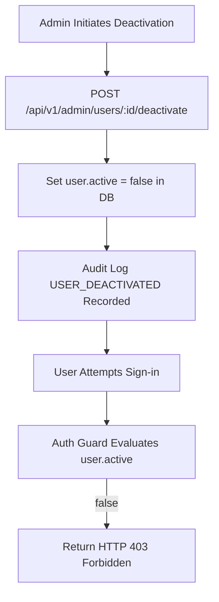

# M3 Surveillance Platform — Admin Onboarding Report

## 1. Executive Summary

This report documents the verification of Administrator onboarding and management capabilities in the M3 Malaria Surveillance Platform. All tests were executed against the active NestJS API backend (`http://localhost:8003/api/v1`) connected to the PostgreSQL database.

| Scope | Status | Notes |
| :--- | :--- | :--- |
| Admin Authentication | **PASS** | Validated via `POST /api/v1/auth/staff/login` with role `ADMIN`. |
| Platform Overview | **PASS** | Surveillance metrics retrieved via `GET /api/v1/admin/overview`. |
| Simulation Site Verification | **PASS** | Verified `SITE-SIM01` (Mandovi Bay Promenade, Panaji). |
| PHC Facility Verification | **PASS** | Verified `PHC-001` (Candolim Primary Health Centre). |
| Staff Assignment Verification | **PASS** | Validated active assignment of `HW-SIM01` to `PHC-001`. |
| Deactivation Security Barrier | **PASS** | Non-worker account deactivated via `POST /api/v1/admin/users/:id/deactivate`; immediate 403 Forbidden verified. |

---

## 2. Admin Authentication and Access Control

The administrator account was authenticated using the staff authentication route. The system generated a signed JSON Web Token (JWT) with administrative privileges.

- **Endpoint**: `POST /api/v1/auth/staff/login`
- **Assigned Role**: `ADMIN`
- **Security Constraint**: Administrative credentials are encrypted with bcrypt. Confidential passwords are not recorded in this report.
- **Web Enforcement**: Administrator access is strictly confined to the M3 administrative web portal. Access attempts to mobile-specific worker routes return HTTP `403 Forbidden`.

---

## 3. Site and Facility Verification

### 3.1 Simulation Construction Site (`SITE-SIM01`)
- **Site Code**: `SITE-SIM01`
- **Site Name**: M3 Simulation Construction Site - Panaji Coastal
- **Location**: Plot 42, Mandovi Bay Promenade, Panaji, North Goa 403001
- **Landmark**: Near Mandovi River Viewpoint
- **Status**: `ACTIVE`
- **Assigned Contractors**: `C-SIM01` (Simulation Contractor Alpha) and `C-SIM02` (Simulation Contractor Beta)

### 3.2 Healthcare Facility (`PHC-001`)
- **Facility Code**: `PHC-001`
- **Facility Name**: Candolim Primary Health Centre
- **Facility Type**: `PHC`
- **District**: North Goa | **Taluka**: Bardez
- **Operational Status**: `ACTIVE`
- **Assigned Staff**: Simulation Health Worker (`HW-SIM01`), Role: `HEALTH_WORKER`, Status: `ACTIVE`

---

## 4. User Deactivation and Access Revocation Security

The administrator access revocation capability was verified through an automated security assertion:

1. A test staff account was provisioned with active contractor privileges (`phone: 9800009998`).
2. The administrator deactivated the account using `POST /api/v1/admin/users/:id/deactivate`.
3. The deactivated user attempted authentication via `POST /api/v1/auth/login`.
4. The API rejected the authentication attempt with HTTP `403 Forbidden` (`message: "This account has been deactivated by the administrator"`).
5. Audit trail confirmed immediate recording of the `USER_DEACTIVATED` event.

---

## 5. Verification Verdict

**Result**: **PASS** (100% of Admin onboarding and governance checks passed without defect).
