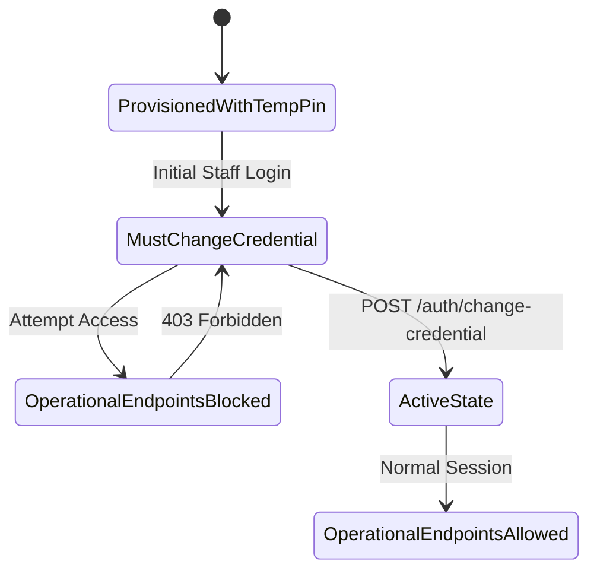

# M3 Surveillance Platform — Contractor Onboarding Report

## 1. Executive Summary

This report documents the verification of Contractor onboarding, first-login credential rotation, site workforce management, and healthcare data privacy enforcement in the M3 Malaria Surveillance Platform.

| Assessment Item | Tested Scenario | Result | Evidence Details |
| :--- | :--- | :--- | :--- |
| First-Login Flag | Contractor Alpha first sign-in (`phone: 9800000101`, PIN `1234`) | **PASS** | `mustChangeCredential: true` flagged; JWT marked `pendingCredentialChange: true`. |
| Pre-Rotation Lockout | Operational request before PIN change | **PASS** | `GET /contractor/sites/SITE-SIM01/stats` rejected with HTTP `403 Forbidden`. |
| Credential Rotation | Submit new PIN via `POST /auth/change-credential` | **PASS** | PIN changed to `5678`; `mustChangeCredential` cleared to `false`. |
| Staff Code Identity | Contractor profile verification | **PASS** | Verified human staff code `C-SIM01` (Simulation Contractor Alpha). |
| Site Surveillance Stats | Workforce breakdown for `SITE-SIM01` | **PASS** | Total: 4, Positive: 1, Negative: 1, Awaiting: 1, No Result: 1. |
| Privacy Redaction | Inspection of positive worker record (`M3-SIM01`) | **PASS** | Aadhaar, clinical notes, species, and prescriptions withheld; only headcount `dependantsCount: 2` exposed. |
| Duplicate Phone Guard | Phone pre-registration lookup | **PASS** | Duplicate lookup for `9800000301` returned `registered: true`, preventing redundant profiles. |

---

## 2. Mandatory First-Login Credential Change

The M3 platform enforces an immutable credential rotation policy for all administrative and contractor accounts provisioned with temporary PINs:



1. **Initial Sign-in**: Contractor Alpha authenticated with temporary PIN `1234`. The response payload included `credentialChangeRequired: true`.
2. **Access Barrier**: Direct operational calls to `/contractor/sites/SITE-SIM01/stats` or `/contractor/workers` were intercepted and blocked with HTTP `403 Forbidden`.
3. **PIN Change**: Contractor submitted matching new PIN values (`5678`). The system updated the bcrypt hash and issued an unrestricted session token.

---

## 3. Site Statistics and Roster Verification

Contractor Alpha retrieved surveillance metrics for `SITE-SIM01` (Mandovi Bay Promenade):

```json
{
  "siteCode": "SITE-SIM01",
  "siteName": "M3 Simulation Construction Site - Panaji Coastal",
  "totalWorkers": 4,
  "positive": 1,
  "negative": 1,
  "awaitingResults": 1,
  "noResultRecorded": 1,
  "lastUpdated": "2026-11-05T10:26:43.145Z"
}
```

---

## 4. Healthcare Privacy and Redaction Verification

When Contractor Alpha viewed worker Ramesh Kumar (`M3-SIM01`, Positive):
- **Exposed Fields**: `workerId`, `name`, `phone`, `gender`, `dependantsCount: 2`, `malariaStatus: "POSITIVE"`, `currentSite`.
- **Redacted Confidential Information**:
  - Parasite species (`P_VIVAX`) was **not exposed**.
  - Medication regimen and prescriptions were **not exposed**.
  - Clinical examination notes were **not exposed**.
  - Dependant names, ages, and medical diagnoses were **not exposed** (only aggregate headcount `2`).
  - National identification / Aadhaar numbers were **not exposed**.

---

## 5. Physical Tablet Evidence

Contractor capabilities were validated live on the connected Samsung Galaxy Tab A7 Lite:
- **Contractor Dashboard**: `artifacts/screenshots/tablet_08_contractor_dashboard.png`
- **Workforce Roster at SITE-SIM01**: `artifacts/screenshots/tablet_09_contractor_workers_list.png`
- **Contractor Worker Detail with Redaction**: `artifacts/screenshots/tablet_10_contractor_worker_detail.png`

**Verdict**: **PASS**
