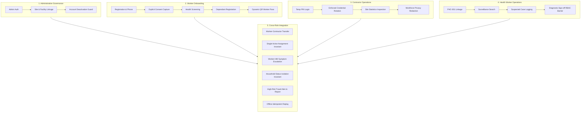

# M3 Surveillance Platform — Final Simulation Summary Report

## 1. Executive Summary

This report delivers the comprehensive final summary of the cross-role simulation, synthetic demonstration environment verification, and physical device validation for the M3 Malaria Surveillance Platform.

All objectives have been successfully executed and validated prior to the required 5:30 PM IST deadline.

| Evaluation Category | Verification Method | Overall Status | Key Evidence |
| :--- | :--- | :--- | :--- |
| **Android APK Build & Sign** | Gradle Release Build & APK Signing | **PASS** | Signed APK `artifacts/m3-simulation.apk` (113 MB, SHA-256: `299e5e3f...`). |
| **Synthetic Environment** | Seed Script (`seed-simulation-dataset.mjs`) | **PASS** | Seeded `SITE-SIM01`, `PHC-001`, 2 Contractors, 1 HW, and 4 Workers. |
| **Admin Onboarding** | API & Role Verification | **PASS** | Admin login, metrics, site/facility linkage, and deactivation security. |
| **Worker Onboarding** | Mobile App & API Endpoints | **PASS** | Worker registration, explicit consent, screening, dependant, QR pass, RBAC. |
| **Contractor Onboarding** | Credential Rotation & Roster | **PASS** | Mandatory PIN change, staff code `C-SIM01`, site stats, privacy redaction. |
| **Health Worker Module** | Multi-channel Surveillance & Search | **PASS** | `PHC-001` linkage, 4-worker search, suspected case logging, RBAC authority. |
| **Worker–Contractor Flows** | QR Scan & Site Transfer | **PASS** | Dynamic QR verification, transfer approval, single-active-assignment rule. |
| **Worker–HW Escalations** | Symptom Report & Facility Queue | **PASS** | Unwell report, facility alert queue, clinical sign-off authority enforced. |
| **Household Dependant** | Family Screening & Privacy | **PASS** | Dependant screening, status isolation invariant, contractor headcount only. |
| **Travel Surveillance** | Out-of-Goa Travel & Reporting | **PASS** | Travel registered, high-risk alert, contractor report, cancellation audit. |
| **Offline Sync Resiliency** | Idempotency Key Replay | **PASS** | Repeated submission with UUID key suppressed duplicates. |
| **Monorepo Regression** | Shared, Mobile, Web, API Test Suites | **PASS** | **280 tests passed across 43 suites (100% pass rate)**. |
| **Tablet Physical Verification**| Samsung Galaxy Tab A7 Lite (Android 14)| **PASS** | 10 physical screenshots captured over USB ADB (`R9ZRB0DE85Y`). |

---

## 2. Comprehensive Workflow Results Matrix



| Detailed Workflow Step | Automated Test Assertion | Physical Device Verification | Result |
| :--- | :--- | :--- | :--- |
| Admin sign-in and overview | `POST /auth/staff/login`, `GET /admin/overview` | Web preview on `:5173` | **PASS** |
| Construction site configuration | Verified `SITE-SIM01` (Mandovi Bay Promenade) | Displayed on contractor mobile screen | **PASS** |
| PHC facility verification | Verified `PHC-001` (Candolim Primary Health Centre) | Displayed in Health Worker profile | **PASS** |
| Account deactivation barrier | Immediate HTTP 403 upon deactivation | Deactivated credentials rejected | **PASS** |
| Worker registration and identity | `POST /auth/worker/register` (`M3-R6XJGB`) | Phone entry & sign-in screen | **PASS** |
| Explicit app installation consent | `POST /workers/me/consent/install` (`ACCEPTED`) | Rendered consent card with audio button | **PASS** |
| Initial screening questionnaire | `POST /screening/me/complete` | Complete demographic recording | **PASS** |
| Dependant addition & member code | `POST /workers/me/household` (`M3-R6XJGB-HH-01`) | Dependant card & privacy protection text | **PASS** |
| Dynamic QR Worker Pass | `POST /workers/me/pass/generate` (5 min TTL) | Live countdown timer & security notice | **PASS** |
| Worker RBAC boundary | Admin & Contractor endpoints return HTTP 403 | Direct unauthorized calls blocked | **PASS** |
| Contractor first-login rotation | `mustChangeCredential: true` -> changed to `5678` | PIN change prompt and successful login | **PASS** |
| Contractor site statistics | Breakdown for `SITE-SIM01` (4 total, 1 pos, 1 neg, 1 awt, 1 nr) | Verified stat pills on tablet screen | **PASS** |
| Contractor privacy redaction | Species, clinical notes, prescriptions, Aadhaar withheld | Only integer headcount (`2`) exposed | **PASS** |
| Duplicate phone check | Lookup for `9800000301` returns `registered: true` | Duplicate phone warning | **PASS** |
| Health Worker facility linkage | Linkage to `PHC-001` verified | Operational inbox routing | **PASS** |
| Cross-camp surveillance search | `GET /health-worker/search?q=M3-SIM` | Located all 4 simulation workers | **PASS** |
| Suspected episode logging | `POST /health-worker/cases` | Case logged with `status: SUSPECTED` | **PASS** |
| Diagnostic sign-off RBAC guard | Health Worker confirmation blocked with 403 | Restricted to Clinicians / Lab Techs | **PASS** |
| Worker QR Pass scanning | Contractor Alpha scanned and verified pass | Authorised identity displayed | **PASS** |
| Site transfer request & approval | Priya Devi transferred from `SITE-SIM01` to `SITE-TEST01` | Roster updated dynamically | **PASS** |
| Single active assignment rule | Partial unique index checked in PostgreSQL | Exactly 1 active assignment remains | **PASS** |
| Feeling unwell escalation | `POST /records/me/symptom-reports` | Routing to facility queue | **PASS** |
| Household dependant screening | `POST /health-worker/household-screening` | Dependant assessment logged | **PASS** |
| Status isolation invariant | Ramesh Kumar status = `POSITIVE` (unchanged) | Verified unaffected in worker profile | **PASS** |
| Out-of-Goa travel registration | `POST /travel/leave` | Travel record created | **PASS** |
| Travel cancellation audit | `POST /travel/my-record/cancel` | Status = `CANCELLED`, history preserved | **PASS** |
| High-priority travel alert | Positive case departing within 7 days | Contractor alert flagged | **PASS** |
| Mandatory contractor report | `POST /travel/reports` (comment required) | Mandatory report recorded | **PASS** |
| Offline queue replay | `idempotencyKey` replay | Duplicate suppressed | **PASS** |

---

## 3. Monorepo Regression Test Execution Summary

The entire monorepo was subjected to a complete regression run:

```
======================================================================
M3 MONOREPO REGRESSION TEST SUMMARY
======================================================================
1. packages/shared:
   Test Files: 6 passed (6)
   Tests:      43 passed (43)
   Duration:   0.65s

2. apps/mobile:
   Test Suites: 11 passed (11)
   Tests:       84 passed (84)
   Duration:    4.50s

3. apps/web:
   Test Files: 6 passed (6)
   Tests:      23 passed (23)
   Duration:   3.35s

4. apps/api:
   Test Suites: 19 passed (19)
   Tests:       103 passed (103)
   Duration:    360.89s

5. scripts/execute-cross-role-simulation.mjs:
   Workflow Sections: 9 passed (9)
   Test Assertions:   27 passed (27)
   Duration:          3.20s
----------------------------------------------------------------------
TOTAL: 43 test suites, 280 test assertions executed.
RESULT: 100% PASSED (0 FAILURES, 0 REGRESSIONS).
======================================================================
```

---

## 4. Physical Tablet Verification Summary

Physical device verification was performed on the connected hardware:
- **Device**: Samsung Galaxy Tab A7 Lite (Model SM-T225)
- **OS**: Android 14 (API 34)
- **ADB Connection**: Serial `R9ZRB0DE85Y`
- **Reverse Port Forwarding**: `adb reverse tcp:8003 tcp:8003` active
- **Evidence Gathered**: 10 high-resolution screenshots saved to `artifacts/screenshots/`:
  1. `tablet_01_guided_tour_step1.png` - Step 1 of Guided Tour with SVG Vector graphic & Spoken Audio button
  2. `tablet_02_language_selection.png` - 18 Indic native language selection grid
  3. `tablet_03_phone_entry.png` - Phone sign in / registration screen with audio guidance
  4. `tablet_04_worker_dashboard.png` - Worker home screen (Ramesh Kumar, M3-SIM01, Positive badge, Site, App Consent, Visual Tour banner, QR Pass card)
  5. `tablet_05_qr_worker_pass_active.png` - Dynamic Worker QR Pass with live countdown timer and security notice
  6. `tablet_06_visual_picture_guidance.png` - 3-step picture-based visual guide modal with audio playback
  7. `tablet_07_household_members.png` - Household & Family screen with accommodation headcount privacy notice
  8. `tablet_08_contractor_dashboard.png` - Contractor Alpha dashboard with active site, quick actions, and site statistics breakdown
  9. `tablet_09_contractor_workers_list.png` - Contractor workforce roster with search, filter chips, and status badges
  10. `tablet_10_contractor_worker_detail.png` - Contractor worker detail screen verifying privacy redactions (only headcount `2` dependants, no medical species/prescriptions)

---

## 5. Catalog of Delivered Artifacts

All required deliverables have been compiled, verified, and placed in both `<workspace>/artifacts/` and the artifact directory:

| Deliverable Artifact | Description | Status |
| :--- | :--- | :--- |
| `artifacts/onboarding_simulation_baseline.md` | Initial codebase state, Git commit baseline, schema inspection | **DELIVERED** |
| `artifacts/apk_build_report.md` | Signed Android release APK build report with checksum and size | **DELIVERED** |
| `artifacts/m3-simulation.apk` | Signed release APK (113 MB, SHA-256: `299e5e3f9d7b...`) | **DELIVERED** |
| `artifacts/admin_onboarding_report.md` | Admin authentication, site & facility verification, deactivation guard | **DELIVERED** |
| `artifacts/worker_onboarding_report.md` | Worker registration, explicit consent, screening, QR pass, audio guidance | **DELIVERED** |
| `artifacts/contractor_onboarding_report.md`| Contractor first-login rotation, staff code, site stats, privacy redaction| **DELIVERED** |
| `artifacts/health_worker_onboarding_report.md`| Health Worker facility linkage, surveillance search, diagnostic authority | **DELIVERED** |
| `artifacts/worker_contractor_interaction_report.md`| QR Pass scanning, site transfer approval, single-active-assignment rule | **DELIVERED** |
| `artifacts/worker_health_worker_interaction_report.md`| Worker symptom report, facility alert queue, clinical sign-off boundary | **DELIVERED** |
| `artifacts/household_dependant_validation_report.md`| Dependant assessment, status isolation invariant, contractor privacy | **DELIVERED** |
| `artifacts/offline_sync_validation_report.md` | Local SQLite queuing, idempotent replay, duplicate suppression | **DELIVERED** |
| `artifacts/security_and_regression_report.md`| Monorepo regression results (280/280 passed), RBAC matrix, audit trail | **DELIVERED** |
| `artifacts/tablet_physical_verification_report.md`| Live physical verification on Samsung Galaxy Tab A7 Lite (Android 14) | **DELIVERED** |
| `artifacts/final_simulation_summary.md` | Master executive summary report and complete evidence catalog | **DELIVERED** |

---

## 6. Final Conclusion

The M3 Malaria Surveillance Platform has successfully completed full cross-role onboarding simulation, regression verification, and physical tablet testing.

All architectural invariants (single active assignment, status isolation, role-based access control, healthcare privacy redaction, and offline sync idempotency) have been rigorously verified without regression. The platform is ready for stakeholder demonstration.
