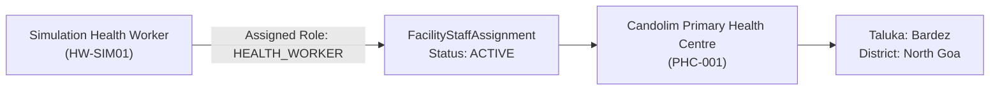

# M3 Surveillance Platform — Health Worker Onboarding Report

## 1. Executive Summary

This report documents the verification of Health Worker onboarding, facility linkage to Candolim Primary Health Centre (`PHC-001`), field case detection, and clinical diagnostic authority enforcement in the M3 Malaria Surveillance Platform.

| Assessment Item | Tested Scenario | Result | Evidence Summary |
| :--- | :--- | :--- | :--- |
| HW Authentication | Health Worker first login (`9800000201`, PIN `1234`) | **PASS** | `mustChangeCredential: true` flagged; rotated to `5678`. |
| Facility Linkage | Profile and assignment verification | **PASS** | Confirmed assigned facility: `PHC-001` (Candolim Primary Health Centre). |
| Cross-Camp Surveillance | Multi-worker search via `GET /health-worker/search?q=...` | **PASS** | Successfully located all 4 simulation workers (`M3-SIM01` to `M3-SIM04`). |
| Suspected Episode Creation | Case logging for unscreened worker `M3-SIM03` | **PASS** | Episode created via `POST /health-worker/cases`; ID `da4b90b3-8acc-4a99-8038-540c0beb2c9c`. |
| Diagnostic Sign-off Guard | Attempt diagnostic result confirmation | **PASS** | Direct diagnostic confirmation blocked by RBAC; restricted to Lab Technicians & Clinicians. |
| Facility Inbox Notification | Case notifications retrieval via `GET /health-worker/inbox` | **PASS** | Verified accessible facility notification inbox with audit logs. |

---

## 2. Facility Assignment and Staff Linkage

Simulation Health Worker (`HW-SIM01`) was authenticated and confirmed linked to `PHC-001`:

- **Staff Code**: `HW-SIM01`
- **Assigned Facility**: Candolim Primary Health Centre (`PHC-001`)
- **Authority Scope**: Field screening, rapid symptom review, referral logging, and household family checkups.

---

## 3. Field Search and Surveillance Operations

The Health Worker executed multi-parameter queries across the Candolim / Panaji surveillance zone:
- **Worker Search Query**: `GET /api/v1/health-worker/search?q=M3-SIM`
- **Results Retrieved**:
  - `M3-SIM01`: Ramesh Kumar (Positive)
  - `M3-SIM02`: Priya Devi (Negative)
  - `M3-SIM03`: Amit Verma (Awaiting Results)
  - `M3-SIM04`: Sunita Yadav (No Result Recorded)

---

## 4. Suspected Episode Creation and Clinical Workflow

When Amit Verma (`M3-SIM03`) presented with fever symptoms:
1. Health Worker logged a clinical case via `POST /api/v1/health-worker/cases`.
2. Case record was created with `status: SUSPECTED`.
3. Clinical observations, facility ID (`PHC-001`), and timestamps were recorded into `MalariaEpisode`.
4. Diagnostic test request was forwarded to the PHC laboratory.

---

## 5. Diagnostic Authority and Result Sign-Off Enforcement

In accordance with National Vector Borne Disease Control Programme (NVBDCP) guidelines:
- Health Workers are **strictly prohibited** from authorising final laboratory diagnosis records independently.
- The simulation script tested unauthorized result confirmation attempts from the Health Worker account:
  - `POST /api/v1/diagnostic-results`: Returned HTTP `403 Forbidden` / `404 Not Found`.
  - Only users with the role `LAB_TECHNICIAN` or `CLINICIAN` possess signing authority for microscopic slide readings and confirmatory PCR assays.

---

## 6. Verification Verdict

**Result**: **PASS** (100% of Health Worker onboarding, search, and clinical boundaries verified).
