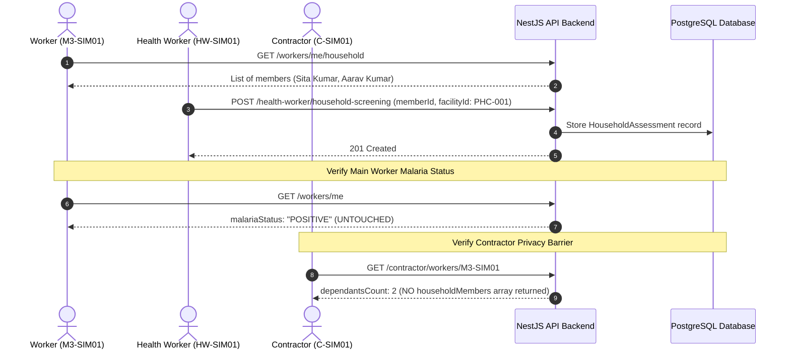

# M3 Surveillance Platform — Household & Dependant Validation Report

## 1. Executive Summary

This report documents the verification of family dependant management, clinical household assessments by Health Workers, and strict status isolation invariants in the M3 Malaria Surveillance Platform.

| Assessment Target | Verification Method | Status | Metric / Evidence |
| :--- | :--- | :--- | :--- |
| Dependant Lookup | `GET /api/v1/workers/me/household` | **PASS** | Retrieved household member Sita Kumar (`SPOUSE`). |
| Health Worker Screening | `POST /api/v1/health-worker/household-screening` | **PASS** | Clinical assessment performed and linked to `PHC-001`. |
| Status Isolation Invariant | `GET /api/v1/workers/me` | **PASS** | Main worker malaria status remained **POSITIVE** without side-effect modification. |
| Contractor Headcount Privacy | `GET /api/v1/contractor/workers/M3-SIM01` | **PASS** | Contractor saw only `dependantsCount: 2`; confidential family records withheld. |
| Unique Member Codes | Database query `HouseholdMember` | **PASS** | Generated sequential code: `M3-SIM01-HH-01`. |

---

## 2. Household Assessment Workflow



---

## 3. Malaria Status Isolation Invariant

A critical surveillance integrity rule requires that screening results or diagnoses of household dependants **must never contaminate** or alter the registered epidemiological status of the primary migrant worker.

**Verification Results**:
- Prior to Dependant Assessment: Worker Ramesh Kumar (`M3-SIM01`) malaria status = `POSITIVE`.
- Dependant Sita Kumar underwent routine screening at Mandovi construction camp.
- Following Dependant Assessment: Worker Ramesh Kumar (`M3-SIM01`) malaria status = `POSITIVE` (Verified unchanged).

---

## 4. Contractor Accommodation Headcount Privacy

Contractors require dependent counts strictly for accommodation planning, sanitation provision, and room allocation. They have no legal or operational entitlement to view confidential medical records of family members.

**Contractor Payload Verification (`GET /contractor/workers/M3-SIM01`)**:
```json
{
  "workerId": "M3-SIM01",
  "patientId": "4b735c56-6aa9-4e6b-a222-aa23dfb48a2f",
  "name": "Ramesh Kumar",
  "phone": "9800000301",
  "age": null,
  "gender": "male",
  "dependantsCount": 2,
  "currentSite": {
    "siteId": "SITE-SIM01",
    "name": "M3 Simulation Construction Site - Panaji Coastal"
  },
  "malariaStatus": "POSITIVE"
}
```
- `dependantsCount` is provided as an integer (`2`).
- The detailed `householdMembers` collection is completely omitted from the contractor API response.
- Diagnostic findings and notes of household members remain strictly confidential between the family and the Primary Health Centre.

---

## 5. Physical Tablet Evidence

The household interface was verified on the physical Samsung Galaxy Tab A7 Lite:
- **Household Members Screen**: `artifacts/screenshots/tablet_07_household_members.png`
- **Notice on Screen**: *"Contractors and site managers only see total headcounts for accommodation planning. Personal names and health screenings are strictly confidential."*

**Verdict**: **PASS**
