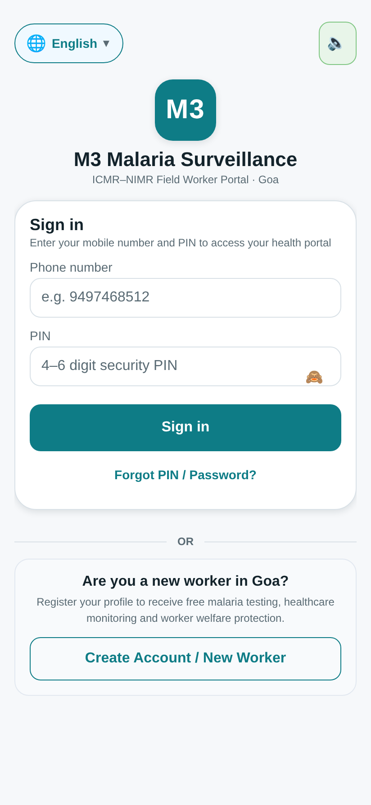
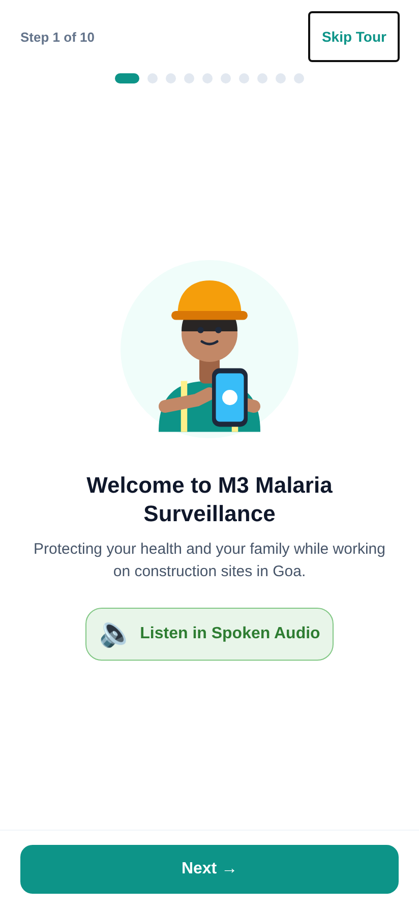
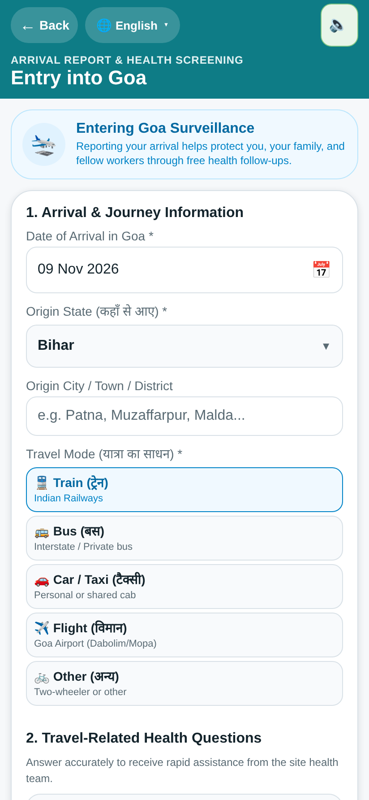
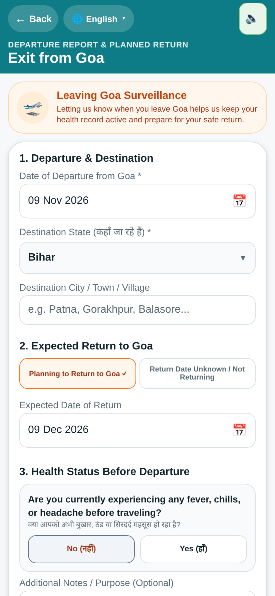
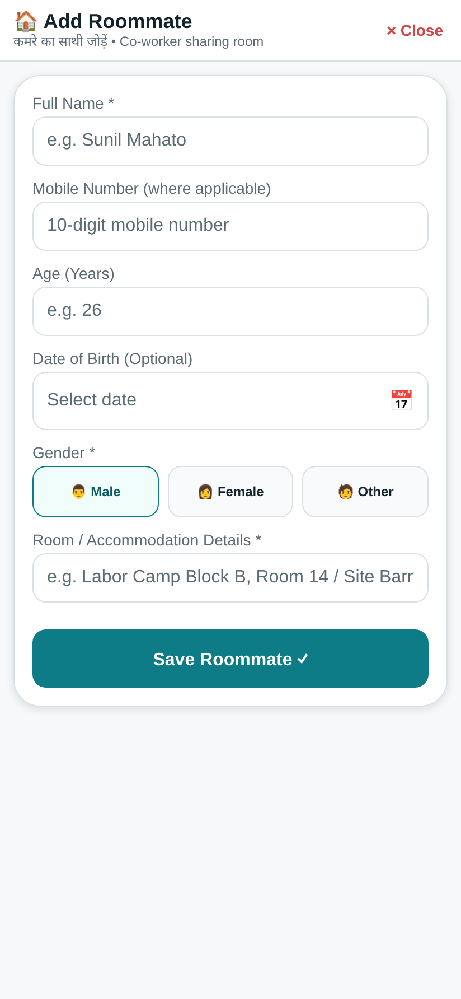
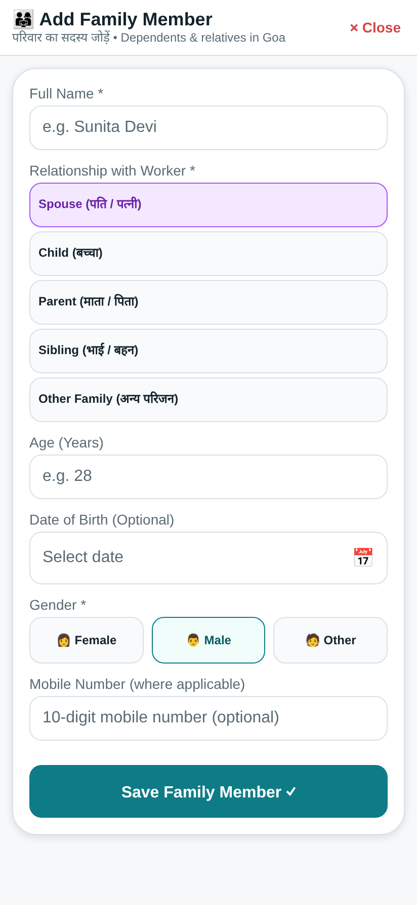
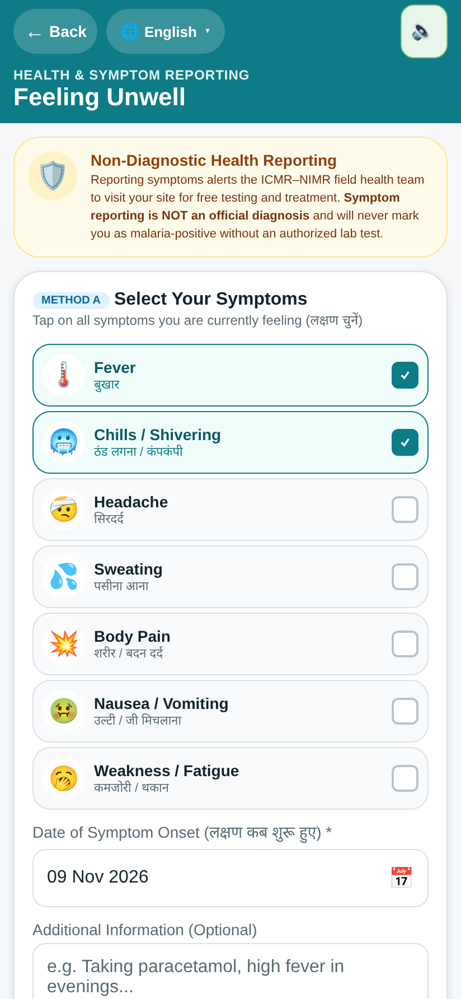
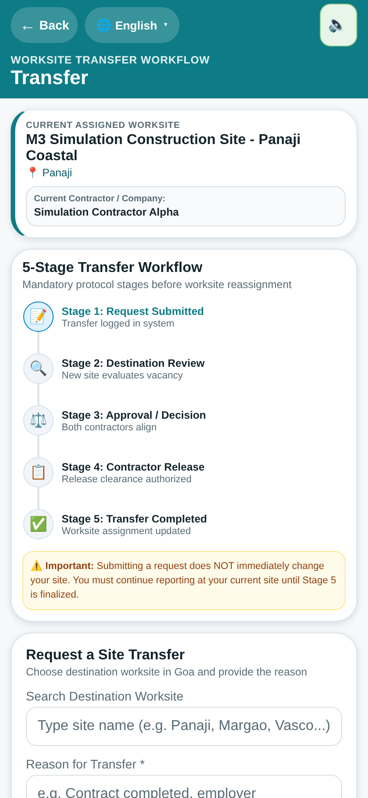
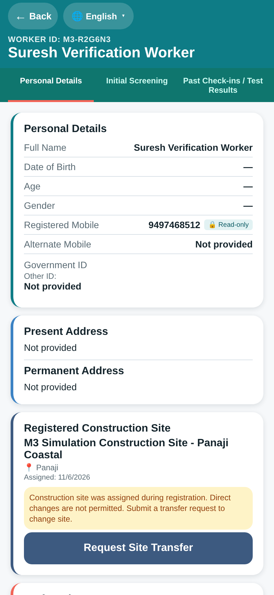

# M3 Malaria Surveillance Worker App — UI Redesign & Implementation Presentation

## Group 1 – Onboarding

| 1. Sign In | 2. Choose Language | 3. Sign Up / New Worker |
| :---: | :---: | :---: |
|  |  |  |

---

## Group 2 – Dashboard and Travel

| 1. Worker Dashboard | 2. Entry in Goa | 3. Exit from Goa |
| :---: | :---: | :---: |
|  |  |  |

---

## Group 3 – Household and Symptoms

| 1. Household | 2. Add Roommate | 3. Add Family Member | 4. Not Feeling Well |
| :---: | :---: | :---: | :---: |
|  |  |  |  |

---

## Group 4 – Additional Worker Features

| 1. Send Symptoms / Record Voice | 2. Transfer Site | 3. Construction Site | 4. Worker Profile | 5. Initial Screening |
| :---: | :---: | :---: | :---: | :---: |
|  |  |  |  |  |
