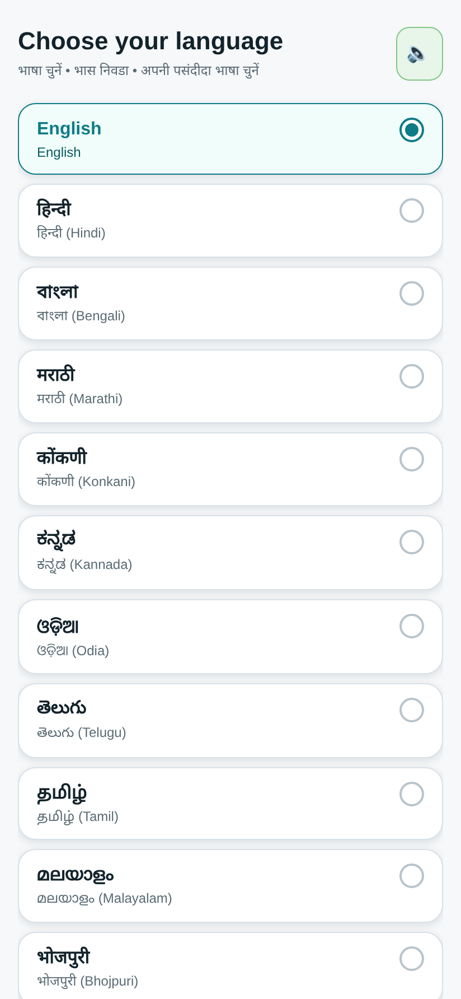
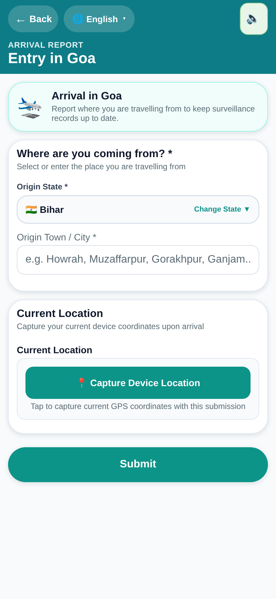
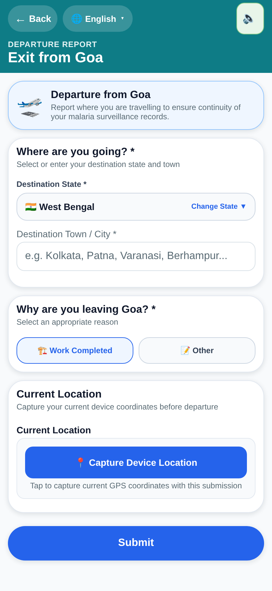
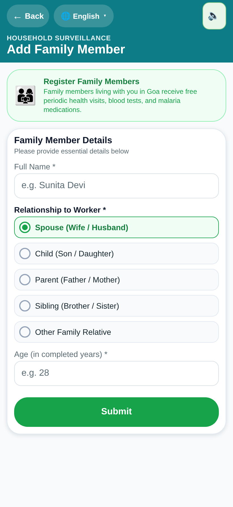
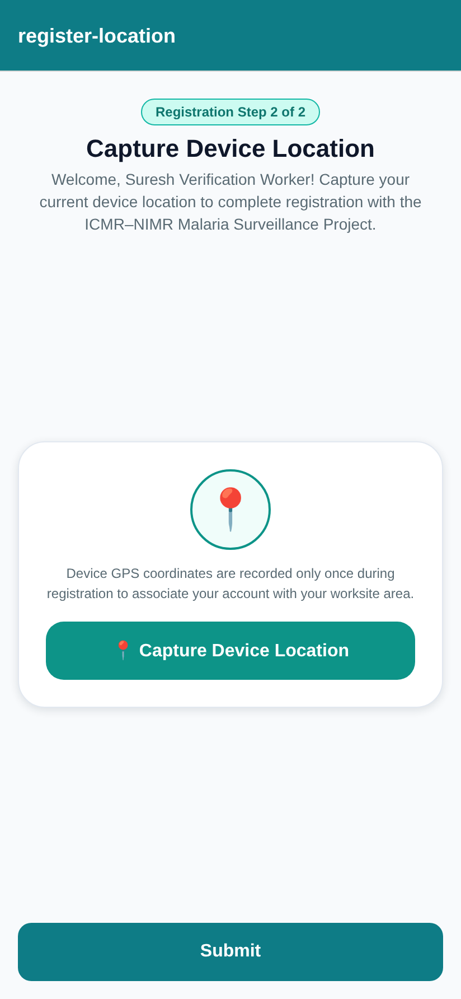

# M3 Malaria Surveillance Worker App — Master UI Redesign & Implementation Presentation

This presentation provides the complete, production-ready visual walkthrough of the **M3 Malaria Surveillance Worker Mobile Application** developed for migrant construction workers under the ICMR–NIMR surveillance project in Goa.

The interface adheres strictly to the approved design system:
- **Consistent smartphone screen layouts** ($412 \times 892$ Android viewport)
- **Light application background** with rounded rectangular cards and large touch-friendly buttons
- **Approved colour palette**:
  - **Teal**: Entry in Goa and location capture
  - **Blue**: Exit from Goa
  - **Red**: Not Feeling Well and symptom reporting
  - **Green**: Family
  - **Purple**: Roommate
  - **Amber/Orange**: Transfer Site
  - **Dark navy**: Main headings
  - **Light grey / white**: Backgrounds and form surfaces
- **Standardised form submission button label**: **Submit** across all forms
- **Dashboard**: Exactly six primary actions (Top: Exit on Left, Entry on Right; Middle: Not Feeling Well on Left, Family on Right; Bottom: Roommate on Left, Transfer Site on Right)

---

## Slide 1 — Authentication Screens

Keep the existing authentication screens and overall design. All form submissions use the standardised **Submit** button label.

| 1. Sign In | 2. Choose Language | 3. Sign Up / Register |
| :---: | :---: | :---: |
|  |  |  |

---

## Slide 2 — Dashboard → Entry in Goa

The dashboard displays exactly six primary actions. Selecting **Entry in Goa** (Top-Right, Teal) opens the streamlined arrival screen containing **only**:
1. **Where are you coming from?** (Origin state picker and town/city field)
2. **Current Location** (Capture Device Location action & state)
3. **Submit** button

*Completely removes the reason field ("Why are you coming to Goa?"), manual dates, and unnecessary travel fields.*

| Dashboard (Top-Right: Entry in Goa) | Entry in Goa Screen |
| :---: | :---: |
|  |  |

---

## Slide 3 — Dashboard → Exit from Goa

Selecting **Exit from Goa** (Top-Left, Blue) opens the departure screen containing:
1. **Where are you going?** (Destination state and town/city field)
2. **Why are you leaving Goa?** (Work Completed or Other)
3. **Current Location** (Capture Device Location action & state)
4. **Submit** button

*No manual date fields; records timestamp automatically.*

| Dashboard (Top-Left: Exit from Goa) | Exit from Goa Screen |
| :---: | :---: |
|  |  |

---

## Slide 4 — Dashboard → Direct Add Family Member Form

Selecting **Family** (Middle-Right, Green) directly opens the single-screen **Add Family Member form**:
- Fields: **Name**, **Relationship**, **Age**
- Submission button: **Submit**
- Displays success state and allows adding another family member without leaving the screen

| Dashboard (Middle-Right: Family) | Direct Add Family Member Form |
| :---: | :---: |
|  |  |

---

## Slide 5 — Dashboard → Direct Add Roommate Form

Selecting **Roommate** (Bottom-Left, Purple) directly opens the single-screen **Add Roommate form**:
- Fields: **Name**, **Age** only (no phone, no Aadhaar, no gender, no room number)
- Submission button: **Submit**
- Displays success state and allows adding another roommate on the same screen

| Dashboard (Bottom-Left: Roommate) | Direct Add Roommate Form |
| :---: | :---: |
|  |  |

---

## Slide 6 — Dashboard → Single-Screen Not Feeling Well Form

Selecting **Not Feeling Well** (Middle-Left, Red) opens one combined reporting screen:
1. **Select Who Is Feeling Unwell**: Checkboxes for Self (always visible), Family (conditional), Roommate (conditional)
2. **Symptom Selection**: 7 approved checkboxes (Fever, Chills, Headache, Sweating, Body ache, Nausea, Weakness)
3. **Optional Voice Recording**: Integrated mic controls (Start, Stop, Play, Re-record)
4. **Device Location Capture**: Current Location coordinates & automatic timestamp
5. **Submission**: Single **Submit** button with non-diagnostic clinical advisory

| Dashboard (Middle-Left: Not Feeling Well) | Single-Screen Symptom Reporting |
| :---: | :---: |
|  |  |

---

## Slide 7 — Dashboard → Transfer Site

Selecting **Transfer Site** (Bottom-Right, Amber/Orange) opens the worksite transfer screen:
1. **Current Site**: Shows worker's currently assigned construction site
2. **Search or Select a Site**: Search field and selectable list of available sites from backend records
3. **Current Location**: Capture Device Location action & state
4. **Submit**: Single **Submit** button associating coordinates and timestamp with backend transfer approval rules

| Dashboard (Bottom-Right: Transfer Site) | Transfer Site Screen |
| :---: | :---: |
|  |  |

---

## Slide 8 — Registration Complete → Capture Device Location

Triggered immediately after successful worker account registration in Sign Up (Step 2 of 2):
- Requests device location permission
- Captures GPS coordinates and associates with registration timestamp
- Shows clear location-captured state
- Graceful retry / fallback handling
- Standardised **Submit** button to continue to the main dashboard

| Registration Complete → Capture Device Location |
| :---: |
|  |

---

## Connected Worker Journey Video Recording

The end-to-end connected worker journey walkthrough has been recorded and verified across the complete 8-slide flow:
- **MP4 Video**: `artifacts/recordings/connected_worker_journey.mp4`
- **WebM Video**: `artifacts/recordings/connected_worker_journey.webm`
