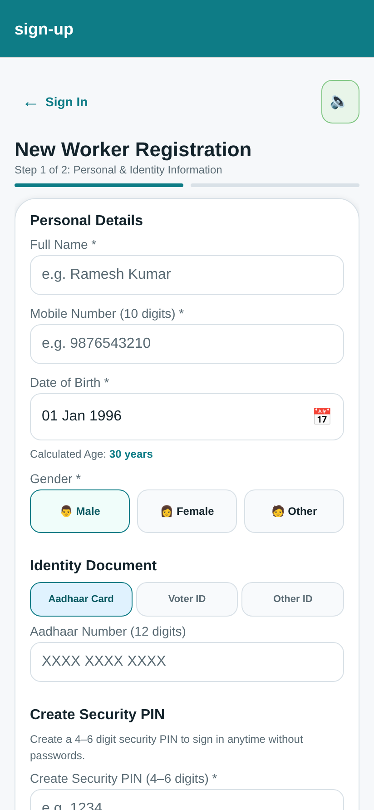
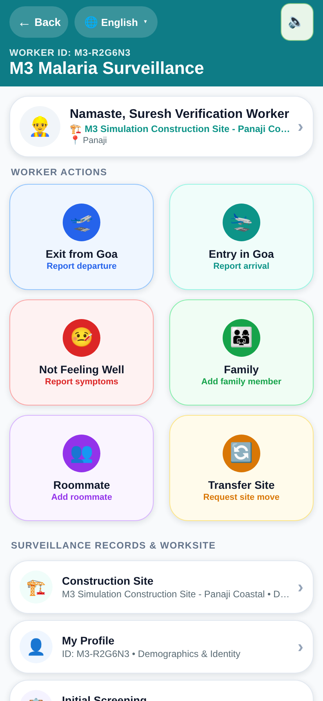
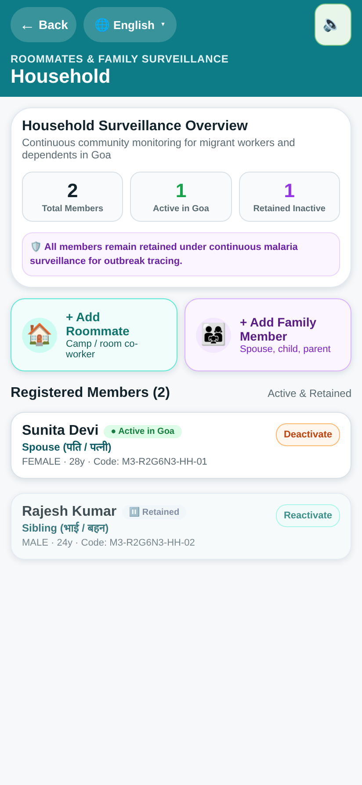
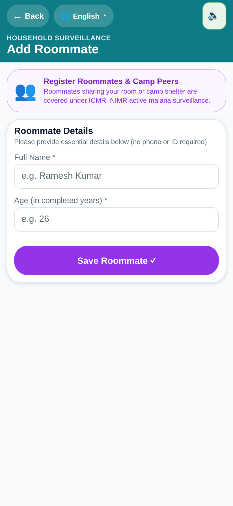
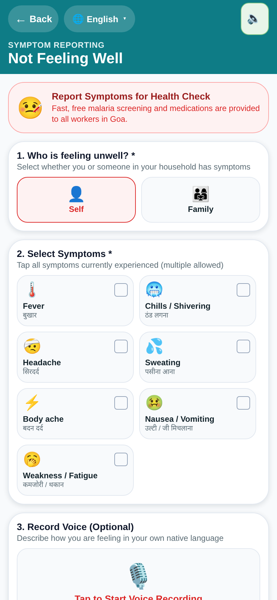
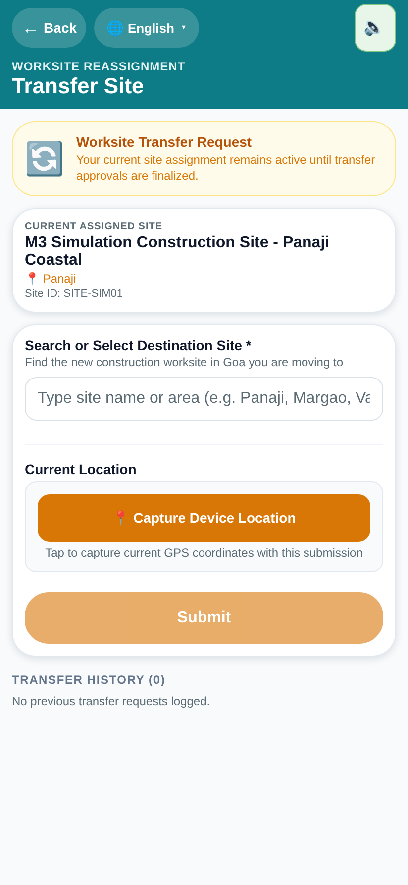
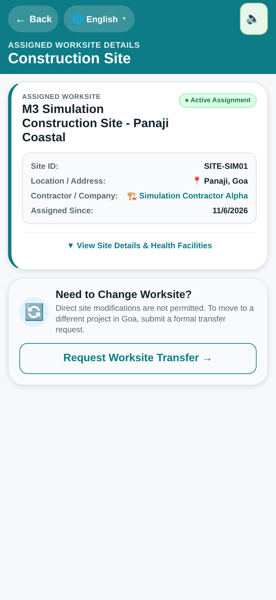
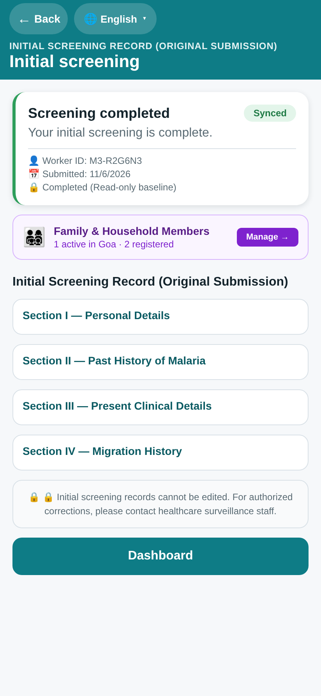

# M3 Malaria Surveillance Worker App — Complete Master UI & Features Presentation

This document presents the complete, modern, production-ready **M3 Malaria Surveillance Worker Mobile Application** for migrant construction workers under the ICMR–NIMR malaria surveillance project in Goa.

All screens are rendered at Android smartphone resolution ($412 \times 892$) with light backgrounds, rounded rectangular buttons, clear icons, and the approved colour system:
- **Teal**: Entry in Goa and registration location capture
- **Blue**: Exit from Goa
- **Red**: Not Feeling Well and symptom reporting
- **Green**: Family
- **Purple**: Roommate
- **Amber/Orange**: Transfer Site
- **Dark Navy**: Headings and important text
- **Light Grey/White**: Screen backgrounds and form fields

---

## Part 1: Authentication & Onboarding Screens

The authentication screens preserve the existing working authentication, 18 Indic language selectors, and 2-step registration with Goa worksite selection.

| 1. Sign In | 2. Choose Language | 3. Sign Up / Register |
| :---: | :---: | :---: |
|  |  |  |

---

## Part 2: Post-Registration Device Location Capture Screen

Immediately after successful worker account registration in Sign Up, the application transitions to this dedicated post-registration location capture step (Step 2 of 2). It requests GPS permission, records coordinates with the registration timestamp, displays a clear location-captured state, and provides a graceful fallback before continuing to the dashboard.

| Post-Registration Location Capture Step (Registration Step 2 of 2) |
| :---: |
|  |

---

## Part 3: Master Dashboard — Primary Actions & Surveillance Worksite Hub

The worker dashboard features the approved **six primary actions** in the top 2-column grid, followed directly by the **Surveillance Records & Worksite Hub** providing 1-tap access to Construction Site details, Worker Profile, Initial Screening baseline records, and Household Management.

| Master Worker Dashboard |
| :---: |
|  |

---

## Part 4: Travel Surveillance — Entry and Exit in Goa

Both travel screens combine device GPS capture and automatic timestamping with the full approved ICMR–NIMR clinical travel surveillance protocol (origin/destination 36-state picker, town/district, travel modes, expected return date, pre-travel and travel fever questions, and treatment details).

| Entry in Goa (Teal) | Exit from Goa (Blue) |
| :---: | :---: |
|  |  |

---

## Part 5: Household Surveillance — Hub, Direct Family & Roommate Workflows

Household management maintains complete epidemiological continuity:
1. **Household Overview Hub**: Displays member list, total count, active/inactive counts, reactivation toggles, and continuous retention (records never deleted).
2. **Direct Add Family Member**: Single-screen form with Name, Relationship (Spouse, Child, Parent, Sibling, Other), and Age.
3. **Direct Add Roommate**: Single-screen form with Name and Age only (no phone, no Aadhaar, no gender required).

| 1. Household Overview Hub | 2. Add Family Member (Green) | 3. Add Roommate (Purple) |
| :---: | :---: | :---: |
|  |  |  |

---

## Part 6: Clinical Reporting — Single-Screen Not Feeling Well Form

Selecting **Not Feeling Well** (Red) opens a combined, single-screen reporting form:
1. **Who is feeling unwell**: Conditional options (Self always visible; Family shown only when family records exist; Roommate shown only when roommates exist).
2. **Approved Symptoms**: 7 multi-select symptom cards (Fever, Chills, Headache, Sweating, Body ache, Nausea, Weakness).
3. **Optional Voice Recording**: Integrated mic recorder with live timer, playback, and re-record.
4. **Device Location**: Embedded GPS capture card with automatic timestamping.
5. **Non-Diagnostic Policy**: Enforces clinical advisory disclaimer without automated diagnosis.

| Single-Screen Not Feeling Well Form |
| :---: |
|  |

---

## Part 7: Worksite Transfer Workflow

Selecting **Transfer Site** (Amber/Orange) displays the worker's current assigned worksite, searchable destination site picker, device location capture, and status tracking under the approved multi-stage contractor clearance protocol (worker-initiated needs current contractor + destination contractor; contractor-initiated needs worker acceptance + current contractor release).

| Worksite Transfer Request |
| :---: |
|  |

---

## Part 8: Construction Site, Worker Profile & Initial Screening Baseline

All existing worker records and surveillance baseline features are retained and fully accessible:
1. **Construction Site**: Displays assigned site name, ID, address in Goa, contractor company, NIMR surveillance desk contact, safety officer contact, and transfer CTA.
2. **Worker Profile**: Authenticated Worker ID (`M3-R2G6N3`), demographics, masked Aadhaar toggle (`formatMaskedAadhaar`), restricted demographic corrections, and test history.
3. **Initial Screening**: Preserves approved Sections I–IV baseline questionnaire (`Questionnaire Updated 1 Sept 2026.docx`), consent gate, SQLite offline drafts, and read-only mode for returning workers.

| 1. Construction Site | 2. Worker Profile & Demographics | 3. Initial Screening Baseline |
| :---: | :---: | :---: |
|  |  |  |

---

## Part 9: Connected Worker Journey Video Recording

The full end-to-end connected worker journey walkthrough has been recorded and verified across all screens:
- **MP4 Video**: `artifacts/recordings/connected_worker_journey.mp4`
- **WebM Video**: `artifacts/recordings/connected_worker_journey.webm`
