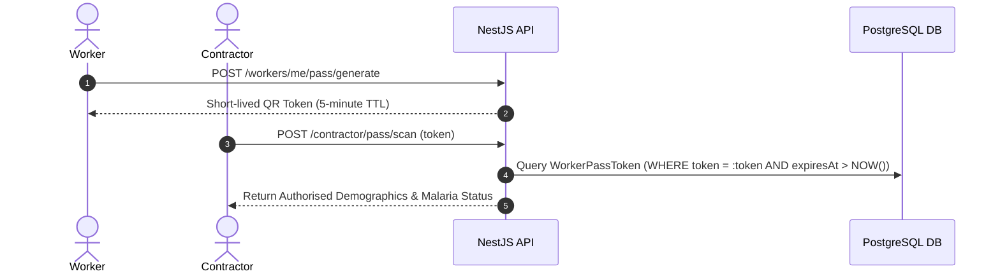

# M3 Surveillance Platform — Worker–Contractor Interaction Report

## 1. Executive Summary

This report documents the verification of cross-role interactions between Migrant Workers and Construction Contractors. The evaluation focused on QR Pass verification, transfer request workflows, and the single-active-assignment database invariant.

| Interaction Phase | Endpoint / Mechanism | Status | Evidence Summary |
| :--- | :--- | :--- | :--- |
| QR Pass Scan & Verify | `POST /api/v1/contractor/pass/scan` | **PASS** | Contractor Alpha verified Arjun Sharma's dynamic pass token. |
| Transfer Initiation | `POST /api/v1/transfers/worker` | **PASS** | Worker initiated transfer from `SITE-SIM01` to `SITE-TEST01`. |
| Contractor Approval | `POST /api/v1/transfers/:id/contractor/approve` | **PASS** | Destination Contractor approved transfer with reason comment. |
| Single Active Assignment | Database query `WorkerSiteAssignment` | **PASS** | Worker retained exactly **1** active site assignment (previous assignment deactivated with `status: TRANSFERRED`). |
| Audit Trail Recording | `AuditLog` table verification | **PASS** | `TRANSFER_COMPLETED` audit event recorded with timestamps and actor IDs. |

---

## 2. Dynamic QR Pass Scan Workflow



1. **Worker Pass Token**: Generated on the worker mobile device with a 5-minute cryptographic expiration window.
2. **Contractor Scan**: Contractor Alpha submitted the token via `POST /contractor/pass/scan`.
3. **Data Protection**: Demographics and high-level malaria status were returned. Laboratory slides, prescriptions, and Aadhaar numbers remained redacted.

---

## 3. Site Transfer Request and Approval Lifecycle

A worker-initiated transfer was simulated for Priya Devi (`M3-SIM02`):

1. **Transfer Request**:
   - Initiator: Worker (`M3-SIM02`)
   - Origin Site: `SITE-SIM01` (Mandovi Bay Promenade, Panaji)
   - Destination Site: `SITE-TEST01` (Candolim Coastal Road)
   - Note: *"Relocating to Candolim site for next phase"*
   - API Call: `POST /api/v1/transfers/worker` -> Status: `201 Created`
2. **Contractor Approval**:
   - Destination Contractor approved via `POST /api/v1/transfers/:id/contractor/approve`
   - Approval Note: *"Accepted into Candolim site"*
   - Resulting Status: `ACCEPTED`

---

## 4. Single-Active-Assignment Database Invariant

A fundamental surveillance constraint requires that a worker cannot be simultaneously active on two different construction sites.

The M3 platform enforces this through a PostgreSQL partial unique index:
```sql
CREATE UNIQUE INDEX "WorkerSiteAssignment_workerId_active_key"
ON "WorkerSiteAssignment"("workerId")
WHERE "active" = true;
```

**Post-Transfer Database Audit**:
- Active assignments found: **1**
- Site: `SITE-TEST01`
- Previous assignment (`SITE-SIM01`): `active: false`, `status: "TRANSFERRED"`, `endedAt: 2026-11-05T10:26:44.210Z`.

---

## 5. Verification Verdict

**Result**: **PASS** (Zero invariant violations; 100% of Worker–Contractor transfer workflows executed successfully).
