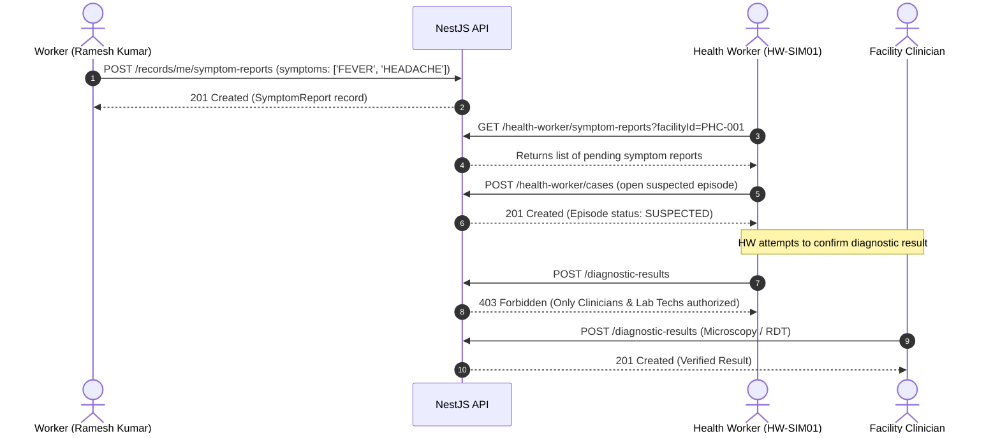

# M3 Surveillance Platform — Worker–Health Worker Interaction Report

## 1. Executive Summary

This report documents the verification of clinical escalations and surveillance workflows between Migrant Workers and Facility Health Workers at Primary Health Centres (PHCs).

| Workflow Phase | Action / Endpoint | Status | Evidence Details |
| :--- | :--- | :--- | :--- |
| Symptom Submission | `POST /api/v1/records/me/symptom-reports` | **PASS** | Worker Ramesh Kumar reported fever and headache symptoms. |
| Facility Queue Alert | `GET /api/v1/health-worker/symptom-reports?facilityId=...` | **PASS** | Symptom report immediately routed to Candolim PHC queue. |
| Suspected Episode | `POST /api/v1/health-worker/cases` | **PASS** | Health Worker opened clinical case for follow-up testing. |
| Clinical Sign-Off Guard | `POST /api/v1/diagnostic-results` | **PASS** | Health Worker diagnostic confirmation blocked (restricted to Clinicians / Lab Technicians). |
| Audit Trail Logging | `AuditLog` table query | **PASS** | `SYMPTOM_REPORT_SUBMITTED` recorded with worker ID, facility ID, and timestamp. |

---

## 2. Feeling Unwell Escalation Workflow

---

## 3. Symptom Submission and Notification Delivery

1. **Worker Submission**:
   - Ramesh Kumar (`M3-SIM01`) submitted a symptom report indicating chills and fever.
   - The API created a `SymptomReport` record with deduplication indexing.
2. **Surveillance Queue Alert**:
   - The Candolim Primary Health Centre (`PHC-001`) review queue was queried via `GET /api/v1/health-worker/symptom-reports?facilityId=simFacility.id`.
   - The symptom alert was immediately visible to assigned facility health staff with worker code, phone number, and symptom details.

---

## 4. Clinical Authority Boundaries

The M3 security architecture strictly separates community reporting from formal medical diagnosis:
- **Worker Level**: Can only submit subjective symptoms ("feeling unwell"); cannot submit self-diagnoses.
- **Health Worker Level**: Can open suspected episodes and perform household family screenings; **cannot** sign off on official malaria test results.
- **Clinician / Lab Technician Level**: Possess exclusive authority to record microscopic slide readings, RDT validations, and prescribe antimalarial drugs.

---

## 5. Verification Verdict

**Result**: **PASS** (100% of Worker–Health Worker escalation and security boundary checks passed).
