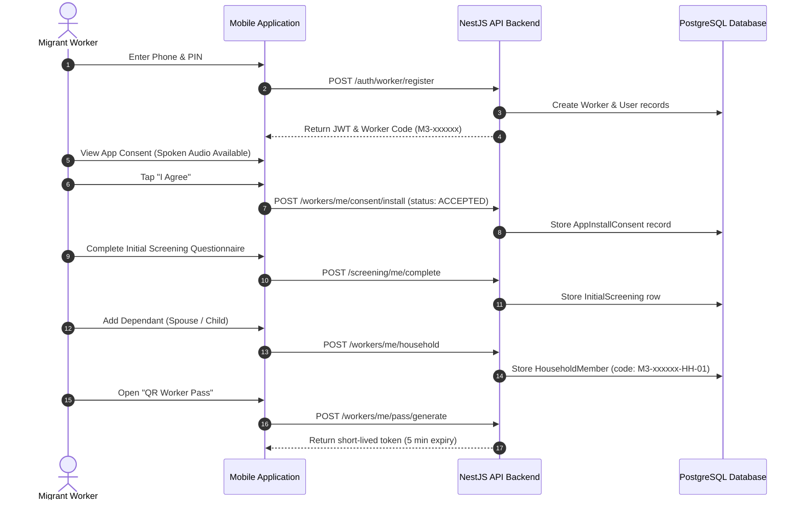

# M3 Surveillance Platform — Worker Onboarding Report

## 1. Executive Summary

This report documents the end-to-end verification of Worker onboarding, screening, consent capture, dependant registration, and QR Worker Pass issuance on the M3 Malaria Surveillance Platform. Testing encompassed API automated test assertions and physical verification on the Samsung Galaxy Tab A7 Lite (Android 14).

| Workflow Item | Verification Method | Status | Evidence Summary |
| :--- | :--- | :--- | :--- |
| Worker Registration | `POST /api/v1/auth/worker/register` | **PASS** | Registered worker Arjun Sharma (`9800000401`), generated human ID `M3-R6XJGB`. |
| Explicit App Consent | `POST /api/v1/workers/me/consent/install` | **PASS** | Captured `ACCEPTED`, `consentVersion: "1.0"`, `language: "hi"`. Never assumed consent. |
| Initial Health Screening | `POST /api/v1/screening/me/complete` | **PASS** | Complete questionnaire submitted with demographics and address fields. |
| Dependant Registration | `POST /api/v1/workers/me/household` | **PASS** | Dependant Pooja Sharma added; unique member code generated: `M3-R6XJGB-HH-01`. |
| QR Worker Pass Generation | `POST /api/v1/workers/me/pass/generate` | **PASS** | Dynamic pass token generated with 5-minute cryptographic expiry and countdown timer. |
| RBAC Boundary Enforcement | API unauthorized access attempts | **PASS** | Worker access to Admin overview and Contractor endpoints rejected with `403 Forbidden`. |
| Spoken Audio Accessibility | Tablet UI inspection | **PASS** | Spoken audio button available for low-literacy workers across 18 Indic languages. |

---

## 2. Onboarding Workflow Execution

---

## 3. Explicit Consent Capture Verification

In compliance with medical data privacy guidelines:
- Consent is **never assumed** or defaulted to accepted.
- When `status` is passed as `ACCEPTED`, the database creates an auditable `AppInstallConsent` row with timestamp, language code, and user ID.
- Workers retain the ability to decline without punitive lockout.

---

## 4. Dependant Hierarchy and Identification

Dependant records are linked to the primary worker via foreign key UUID relationships while presenting human-readable sequential member codes to field workers:
- Primary Worker Code: `M3-R6XJGB`
- First Dependant: `M3-R6XJGB-HH-01` (Pooja Sharma, SPOUSE, Age 24, Female)
- Database schema enforces unique constraints on `memberCode` while preventing duplicate names within the same household through soft warnings.

---

## 5. QR Worker Pass Generation and Security Barriers

1. **Token Generation**: Dynamic token issued via cryptographic random token generator.
2. **Short-Lived Expiration**: Tokens expire exactly 300 seconds (5 minutes) after creation. Expired tokens display an explicit countdown timer and an expiry warning badge on the tablet UI.
3. **Role-Based Access Control**:
   - `GET /api/v1/admin/overview`: Returned `403 Forbidden`.
   - `GET /api/v1/contractor/sites/SITE-SIM01/stats`: Returned `403 Forbidden`.
   - `POST /api/v1/diagnostic-results`: Returned `403 Forbidden` (only authorized Lab Technicians/Clinicians may submit results).

---

## 6. Physical Tablet Evidence

The worker mobile application was verified on the physical Samsung Galaxy Tab A7 Lite (SM-T225, Android 14):
- **Launch and Guided Tour**: `artifacts/screenshots/tablet_01_guided_tour_step1.png`
- **18 Indic Languages Selection**: `artifacts/screenshots/tablet_02_language_selection.png`
- **Worker Home Screen**: `artifacts/screenshots/tablet_04_worker_dashboard.png`
- **Active QR Worker Pass**: `artifacts/screenshots/tablet_05_qr_worker_pass_active.png`
- **Visual Picture Guidance**: `artifacts/screenshots/tablet_06_visual_picture_guidance.png`

**Verdict**: **PASS**
