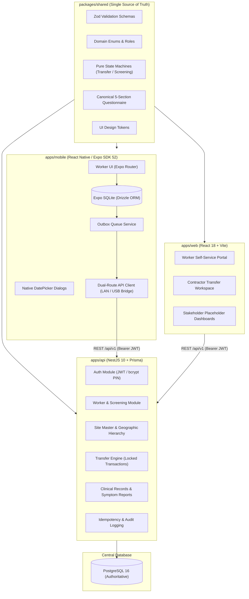
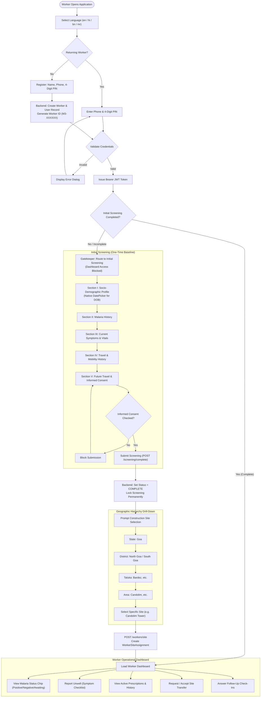
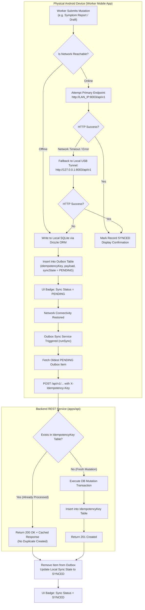
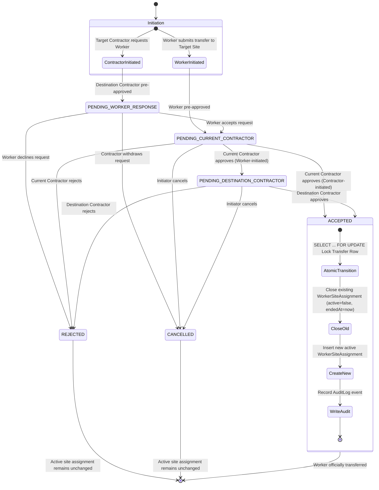
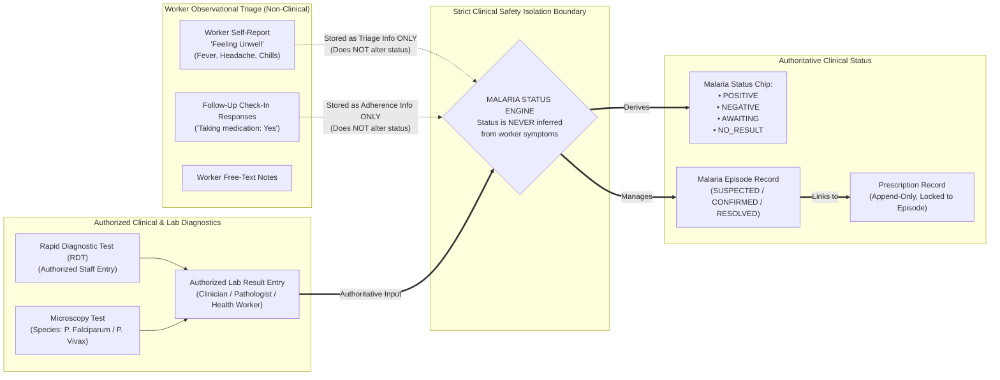
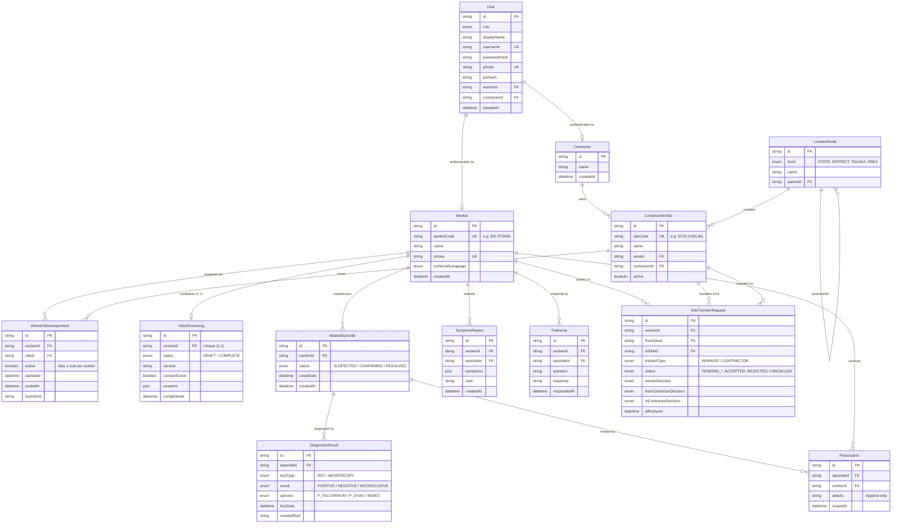

# M3 Malaria Surveillance Platform — Master Architecture, Prompt & Flowcharts

> **Project Identifier**: `M3-SURVEILLANCE-2026`  
> **System Scope**: Real-time Malaria Surveillance, Clinical Tracking, Migrant Worker Registration, and Site Transfer Orchestration across Construction Sites.

---

## 1. Master System Prompt

Use this prompt to instruct any AI coding agent, engineering team, or system architect to understand, maintain, or rebuild the M3 platform:

```markdown
You are an expert full-stack systems architect and clinical software engineer specializing in healthcare surveillance, distributed offline-first mobile systems, and high-concurrency transactional architectures.

Your task is to work on the M3 Malaria Surveillance Platform — a mission-critical platform designed to track malaria prevalence, screening, diagnosis, prescriptions, and labor mobility among construction workers in endemic regions (specifically Goa, India).

### CORE ARCHITECTURAL PRINCIPLES & NON-NEGOTIABLES

1. STRICT SINGLE SOURCE OF TRUTH (DRY Monorepo):
   - All shared types, enums, Zod validation schemas, UI design tokens, the canonical 5-section Initial Screening Questionnaire, and pure domain state machines (such as site transfers and screening completeness) MUST reside strictly in `packages/shared`.
   - Never duplicate enums or business logic between `apps/api`, `apps/web`, and `apps/mobile`.

2. CLINICAL INTEGRITY & DIAGNOSTIC SEPARATION:
   - Malaria status (NO_RESULT, AWAITING, POSITIVE, NEGATIVE) MUST NEVER be inferred or modified based on self-reported symptoms.
   - Malaria status is derived EXCLUSIVELY from authorized clinical diagnostic tests (RDT or Microscopy) recorded by authorized clinical personnel.
   - Symptom reports ("Feeling unwell") and follow-up check-ins are purely observational triage logs and must remain isolated from diagnostic outcomes.
   - Prescriptions are strictly append-only and linked directly to an active Malaria Episode. Past prescriptions can never be overwritten or deleted.

3. WORKER REGISTRATION & SCREENING GATEKEEPING:
   - Every worker receives a human-readable, stable Worker ID (e.g., `M3-7F3K9A`) and is authenticated via Phone + 4-digit PIN (bcrypt hashed; plain text PINs must never be stored or logged).
   - Gating: A newly registered worker is immediately routed to the 5-Section Initial Screening Questionnaire. Access to the operational dashboard is blocked until screening is COMPLETE.
   - Screening Idempotency: Baseline screening is completed exactly once per worker. Drafts may be saved and resumed, but once submitted with informed consent and all required answers, it is sealed permanently (HTTP 409 Conflict on re-submission).

4. OFFLINE-FIRST RESILIENCE (Mobile):
   - The mobile client (Expo / React Native) must remain functional without internet connectivity.
   - Local persistence uses Expo SQLite with Drizzle ORM (`screening_draft`, `symptom_report`, `follow_up_response`, and `outbox`).
   - Mutations made offline are stored in the `outbox` with client-generated UUID idempotency keys.
   - Sync states (LOCAL, PENDING, SYNCED, FAILED) must be surfaced explicitly to the user. A local unconfirmed action must NEVER be displayed as server-confirmed.
   - Network resilience: The mobile API client must support dual-route automatic fallback (attempt primary LAN IP; fallback transparently to USB reverse bridge `127.0.0.1:8003` if network drops).

5. SITE TRANSFERS & CONCURRENCY CONTROL:
   - Workers belong to Construction Sites via `WorkerSiteAssignment`. A worker may have at most ONE active site assignment at any time (`uq_active_assignment_per_worker`).
   - Site transfers require multi-party consensus:
     - Worker-initiated: Worker proposes -> Current Contractor approves -> Destination Contractor approves.
     - Contractor-initiated: Destination Contractor initiates -> Worker accepts -> Current Contractor approves.
   - Enforce at most one non-terminal transfer per worker (`uq_open_transfer_per_worker`).
   - Atomic assignment transition: The final approving decision must execute inside a PostgreSQL interactive transaction with a `SELECT ... FOR UPDATE` row lock on `SiteTransferRequest`, atomically closing the prior assignment (`active=false, endedAt=now()`) and opening the new active assignment.

6. ROLE-BASED ACCESS CONTROL (RBAC):
   - Defined roles: `WORKER`, `CONTRACTOR`, `HEALTH_WORKER`, `CLINICIAN`, `PATHOLOGIST`, `RESEARCH_LAB`, `ADMIN`.
   - The backend is the sole authority for role permissions. Contractors can only view or act on workers currently or prospectively assigned to sites owned by their contractor record.

7. COMPLIANCE & ACCESSIBILITY:
   - Target mobile users are construction laborers who may possess low digital literacy.
   - Maintain clear touch targets, multi-lingual support (English, Hindi, Bengali, Marathi), and native DatePicker dialogs for all full-date inputs.
   - Write all user-facing copy and instructions in ASD-STE100 Simplified Technical English: active voice, short sentences, plain terminology.
```

---

## 2. Written Architecture Specification

### 2.1 Monorepo Topography

The codebase is organized as a unified monorepo:

```
m3/
├── packages/
│   └── shared/                # Core domain library (CJS + TypeScript definitions)
│       ├── src/
│       │   ├── design/        # Palette, typography, spacing, semantic tokens
│       │   ├── enums.ts       # Roles, Statuses, TestTypes, Species, Levels
│       │   ├── logic/         # Pure state machines (transfer.ts, screening.ts, status.ts)
│       │   ├── questionnaire.ts # Canonical 5-section screening questions & validation
│       │   ├── roles.ts       # RBAC role definitions and helpers
│       │   └── schemas/       # Zod schemas for auth, workers, sites, transfers, records
├── apps/
│   ├── api/                   # Backend REST service (NestJS 10 + Prisma + PostgreSQL 16)
│   │   ├── prisma/            # schema.prisma, migrations, seeds
│   │   └── src/
│   │       ├── auth/          # JWT strategy, bcrypt hashing, PIN authentication
│   │       ├── workers/       # Worker profile, Worker ID lookup, site assignments
│   │       ├── sites/         # Geographic tree (State->District->Taluka->Area) & site search
│   │       ├── screening/     # Draft saving, completeness evaluation, completion
│   │       ├── records/       # Episodes, diagnostics, prescriptions, symptom reports, followups
│   │       ├── transfers/     # Transactional transfer state machine & locking
│   │       ├── common/        # Idempotency, audit logger, exception filter, RBAC guard
│   │       └── meta/          # System health and questionnaire schema definition
│   ├── web/                   # Responsive web application (React 18 + Vite + React Router 6)
│   │   └── src/               # Worker self-service, contractor transfer dashboard, role placeholders
│   └── mobile/                # Physical Android / iOS app (React Native 0.76 + Expo SDK 52)
│       ├── app/               # Expo Router file-based navigation (Worker portal)
│       └── src/
│           ├── api/           # Resilient dual-route API client with LAN/USB fallback
│           ├── db/            # Expo SQLite database client and Drizzle ORM schema
│           ├── services/      # Outbox background sync and screening persistence
│           ├── components/    # Reusable UI controls, native DatePickerField, status chips
│           └── i18n/          # Locales (English, Hindi, Bengali, Marathi)
```

### 2.2 Data Layer & Concurrency Model

- **PostgreSQL 16**: Authoritative central store managed through Prisma ORM.
- **UUID Primary Keys**: Every entity uses UUID v4 as its internal identifier.
- **Human-Facing Stable Identifiers**:
  - `Worker.workerCode`: Nanoid-generated alphanumeric key prefixed with `M3-` (e.g. `M3-7F3K9A`).
  - `ConstructionSite.siteCode`: Unique site code (e.g. `SITE-CNDLM1`).
- **Partial Unique Indexes**:
  1. `uq_active_assignment_per_worker`: Ensures `WorkerSiteAssignment` has at most one record where `active = true` per worker.
  2. `uq_open_transfer_per_worker`: Enforces that each worker can have at most one pending (non-terminal) `SiteTransferRequest`.
- **Serialised State Transitions**:
  - Transfer decision endpoints lock the target transfer row using `SELECT ... FOR UPDATE` within an interactive Prisma transaction.
  - State transitions are calculated using pure shared domain logic (`computeTransferStatus`).
  - If the decision reaches final consensus (`ACCEPTED`), the active assignment switch and audit record write occur within the exact same atomic transaction.

### 2.3 Resilient Networking & Offline-First Strategy

1. **Local Outbox Pattern**:
   - When a worker reports symptoms while offline, a record is inserted into local SQLite (`symptom_report` and `outbox`).
   - The outbox stores the endpoint, HTTP method, JSON payload, and a persistent client-generated `idempotencyKey`.
2. **Sync Drainage**:
   - `runSync(token)` processes outbox items sequentially.
   - The backend validates the `IdempotencyKey` table. If the server already processed that key, it returns the cached result without creating a duplicate record.
3. **Dual-Route Client Fallback**:
   - In physical field test deployments (e.g. Android tablets connected to local developer workstations via ADB or Wi-Fi):
   - The mobile client attempts the configured LAN endpoint (`http://<LAN_IP>:8003/api/v1`).
   - If a network error or connection timeout occurs, it automatically retries against `http://127.0.0.1:8003/api/v1` via the active `adb reverse tcp:8003 tcp:8003` tunnel.

---

## 3. Visual Flowcharts (Mermaid)

### Diagram 1: System Topology & Monorepo Interactions



---

### Diagram 2: End-to-End Worker Journey & Registration Gate



---

### Diagram 3: Offline-First Synchronization & Outbox Engine



---

### Diagram 4: Multi-Party Site Transfer State Machine



---

### Diagram 5: Clinical Safety & Diagnostic Separation



---

### Diagram 6: Database Entity Relationship Diagram (ERD)


